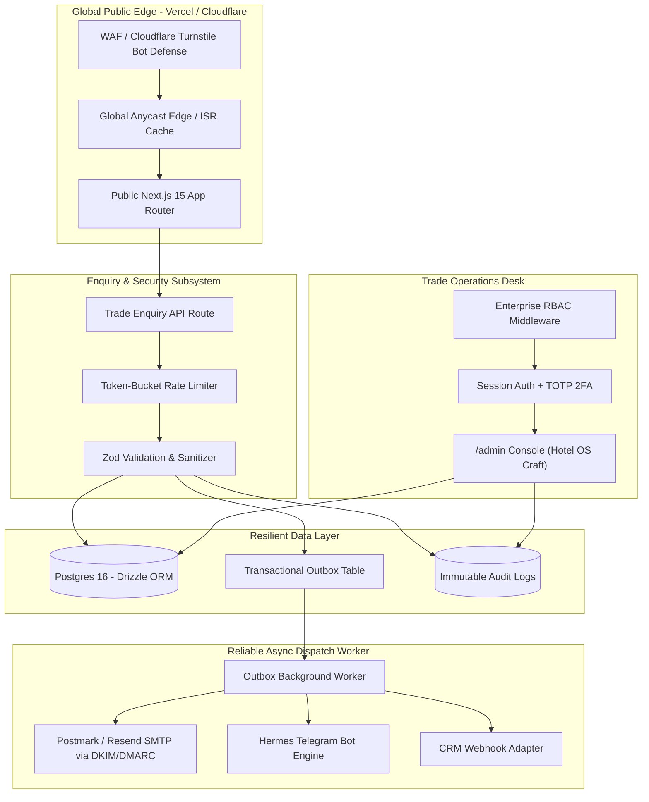
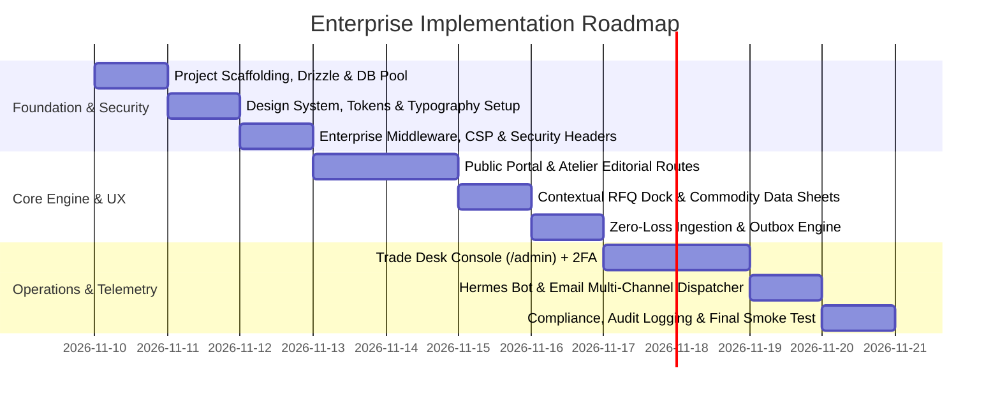

# SRN Website — Enterprise Architectural & Experience Specification

**Project:** SRN PRINTOTRADING PRIVATE LIMITED (`srnglobal.in`)  
**Public brand:** SRN  
**Motto:** Serenity · Resilience · Nobility  
**Classification:** Enterprise B2B Merchant Export & Global Sourcing Platform  
**Standard Tier:** Tier-1 Enterprise Grade (Zero-Loss Reliability · Bank-Grade Security · Bespoke Atelier UX)  
**Status:** Approved & Upgraded Master Plan  
**Workspace:** `c:\GitHub\SBN`  
**Date:** 2026-11-10  

---

## 1. Executive Summary & Category Definition

| Attribute | Specification |
|:---|:---|
| **Primary Category** | Global B2B Merchant Export, Trade Finance & Procurement Platform |
| **Operational Subtype** | International Wholesale Catalogue, Trade Specification Engine & RFQ (Request for Quotation) Lead Matrix (Non-transactional checkout) |
| **Primary Audience** | Global Procurement Heads, Commercial Importers, Institutional Distributors, Retail Wholesalers, Buying Houses, and Supply Partners across EMEA, Americas, APAC, and GCC |
| **Core Conversion Goal** | Secure verified, high-value **Trade Enquiries / RFQs** with detailed technical specifications, volume projections, packaging requirements, target Incoterms, and destination ports |
| **Brand Differentiator** | Multi-sector industrial heritage (Group background: engineering, consulting, construction, modular manufacturing, asset advisory) combined with artisanal and commodities sourcing depth |
| **Non-Goals** | Consumer D2C retail, SaaS platform, self-checkout e-commerce cart, generic startup landing page, low-effort corporate brochure |

### Surfaces & Access Domains
1. **Public Atelier Portal (`/`)** — High-speed, editorial, multi-device trade showcase, product specification registry, and contextual RFQ engine.
2. **Trade Operations Desk (`/admin`)** — Denser, secure, keyboard-efficient operations console for enquiry triage, CRM sync, audit trails, and CMS publication.
3. **Hermes Field Bus (Telegram Bot)** — Out-of-band operational interface for mobile notifications, urgent RFQ claiming, and lead escalations.

---

## 2. Core Architectural Principles & Invariants

1. **Zero-Loss Lead Guarantee:** No buyer enquiry may ever be dropped due to network blips, external API downtime, or database deadlocks. Enquiries are committed in local transactional storage before asynchronous notifications (Telegram, Email, CRM) are fired.
2. **Defensive Enterprise Security:** Zero trust by default. Least-privilege access, strict Content Security Policy (CSP), automated rate-limiting, bot and spam mitigation, and strict input sanitization across all ingestion vectors.
3. **Export House Atelier Aesthetic:** Rejection of generic SaaS kits, neon accents, floating cards, and artificial marketing urgency. The visual and tactile tone mimics a premier London or Geneva export trading house — calm, grounded in material truth, precise, and authoritative.
4. **Local-First, Cloud-Ready:** Immediate frictionless local development and verification (`next dev`, Docker/local Postgres, `.env.local`), structured for seamless deployment to Vercel and managed Postgres (Supabase/Neon) without schema or code churn.

---

## 3. Brand Identity, Visual Direction & Elite UI/UX Standards

### 3.1 Design Metaphor: *Export House Atelier*
The interface merges the tactile gravitas of high-grade paper, merchant shipping documents, and natural commodity textures with Swiss typographical rigor and responsive digital speed.

```
┌────────────────────────────────────────────────────────────────────────┐
│  SRN   ·   Serenity · Resilience · Nobility             [Trade Enquiry]│
├────────────────────────────────────────────────────────────────────────┤
│                                                                        │
│  INDIAN SOURCING. GLOBAL RELATIONSHIPS.                                │
│                                                                        │
│  From India's premier agricultural belts, artisan clusters,            │
│  and manufacturing centers to global enterprise buyers.                │
│                                                                        │
│  [Explore Sourcing Portfolio]        [Download Corporate Dossier (PDF)]│
│                                                                        │
├────────────────────────────────────────────────────────────────────────┤
│  PROVEN GROUP TRACK RECORD:                                            │
│  Taj Hotels  ·  JW Marriott  ·  Radisson  ·  State Cricket Boards      │
└────────────────────────────────────────────────────────────────────────┘
```

### 3.2 Chromatic & Material Palette
Strict ratios prevent the site from slipping into gaudy "luxury" or sterile corporate blue:

| Token Name | Hex Code | Role | Usage Ratio |
|:---|:---|:---|:---|
| **Canvas / Paper** | `#FBF9F5` / `#F4F0E8` | Archival warm stone paper; readable, tactile background | ~65% |
| **Carbon Ink** | `#121316` / `#1E2024` | Primary high-contrast text, borders, structural dividers | ~20% |
| **Maritime Navy** | `#0D1B2A` | Grounded framing, footer surfaces, formal headers | ~10% |
| **Burnished Bullion** | `#C5A059` / `#9E7D3B` | Logo emblem, hairline rules, focus states, verified badges | ~5% max |
| **Field Sage / Terra** | `#3B5249` / `#8B4513` | Subtle category taxonomy indicators (Agro / Handicrafts) | Minimal accent |

### 3.3 Typography Hierarchy
- **Editorial Display (H1, Lead Quote):** Refined, high-character serif (`Cormorant Garamond` / `Fraunces` via `next/font/google`). Gives institutional weight and trade lineage.
- **Structural Interface (H2–H6, Nav, Buttons):** Geometric grotesque sans (`Plus Jakarta Sans` or `Geist Sans`). Crisp, neutral, and readable at all viewports.
- **Technical & Specification Data (HS Codes, Lot Sizes, Metrics, Ports):** Monospace tabular numbers (`JetBrains Mono` or `Geist Mono`). Renders specifications with laboratory precision.

### 3.4 Enterprise UX Innovations ("Way Above Standard")
1. **Contextual RFQ Drawer & Multi-Item Lot Builder:**  
   Buyers do not want to fill 5 separate enquiry forms if they want cumin, cardamom, and handicrafts. As buyers browse, they can click `Add to RFQ Matrix`. A lightweight floating dock shows their selected commodities, allowing them to dispatch a consolidated multi-line trade tender in one go.
2. **Commodity Technical Data Sheets:**  
   Every product displays international trade specs: **HS Code (Harmonized System)**, Botanical/Scientific name, Grade/Mesh, Moisture %, Standard Export Packaging (Jute bags, HDPE drums, Corrugated cartons), and standard Shipping Containers (FCL/LCL).
3. **Incoterms & Port Assistant:**  
   The enquiry form features an interactive selector for Incoterms 2020 (`FOB`, `CIF`, `CFR`, `EXW`, `DDP`) with pre-populated major Indian export gateways (JNPT Mumbai, Mundra, Chennai, Cochin, Kolkata ICD) to eliminate commercial ambiguity upfront.
4. **Interactive 5-Stage Trade Assurance Flow:**  
   A visual, non-abstract step-by-step pipeline illustrating:
   `Specification & Sampling` → `Commercial Terms & LC/Escrow` → `Quality Inspection (SGS / Intertek)` → `Customs Clearance & Phytosanitary Certification` → `Bill of Lading (B/L) & Port Dispatch`.
5. **Universal Accessibility (WCAG 2.1 AA+ Certified):**
   - Minimum 4.8:1 contrast across all text elements.
   - Visible, accessible keyboard focus rings (`outline: 2px solid #C5A059; offset: 2px`).
   - Screen-reader tags (`aria-live`, `aria-expanded`, semantic `<main>`, `<nav>`, `<aside>`).
   - `prefers-reduced-motion` compliance across all CSS animations.
6. **Hard Aesthetic Bans:**  
   No floating glassmorphism or blur cards on marketing pages; no neon gradient buttons; no cartoon iconography; no dark-mode flip on marketing (remains archival paper light); no generic stock AI humans with headsets.

---

## 4. Human-First Content Strategy & Brand Governance

All copy is anchored in the facts from `SRN website content.docx` and elevated to the voice of a seasoned international merchant:

### 4.1 Voice & Tone Guidelines
- **Calm, Matter-of-Fact, Specific:** Use trade nomenclature (lots, crop season, FOB, moisture grade, master cartons, fumigation, artisan cooperatives) rather than empty advertising fluff.
- **Banned Clichés:** *“Unlock the potential”, “Seamless end-to-end solutions”, “Disrupting global trade”, “World-class leader”, “Passion for excellence”*.
- **Integrity Rule on Group Credentials:** Accurately present hospitality and corporate credentials (Taj Hotels, JW Marriott, Radisson, Le Méridien, regional cricket boards, major hospitals) as the **diversified parent group’s track record**, establishing institutional reliability without making unverified claims about SRN’s specific export history.
- **Human Review Gate:** Mandatory "read aloud" verification for Home, About, and Product pages. If it sounds like a Silicon Valley SaaS pitch or generic AI prose, it must be rewritten.

### 4.2 Complete Product Taxonomy & Scope
1. **Spices & Herbs:** Whole and ground spices (Black pepper, green cardamom, turmeric fingers/powder, cumin seeds, dry red chillies, ginger), culinary herbs, certified export grades.
2. **Agro Commodities:** Grains, pulses, oilseeds, specialty basmati rice, regional agricultural staples aligned with destination market quarantine standards.
3. **Packaged Foods:** Premium biscuits, gourmet cookies, tea cakes, and authentic puffed rice (*moori/muri*) in private-label or bulk packaging.
4. **Perfumes & Fragrances:** Attars, essential oils, regional perfume compounds, commercial perfume formulations for wholesale distributors.
5. **Garments & Apparel:** Woven and knitted textiles, institutional uniforms, home textiles, and garments tailored to buyer sizing, fabric GSM, and volume.
6. **Handicrafts, Artefacts & Artworks:** Authentic regional Indian brassware, carved woodwork, pottery, handwoven textiles, and bespoke architectural decorative pieces sourced directly from artisan guilds.

---

## 5. Enterprise System Architecture



### 5.1 Architecture Stack Specifications

| Layer | Enterprise Selection | Justification |
|:---|:---|:---|
| **Framework** | Next.js 15 (App Router, React 19, Server Components) | Zero-latency initial HTML, optimal SEO indexing for international trade searches, tight boundary between public and protected routes |
| **Styling** | Tailwind CSS v4 + Radix UI Primitives (Unstyled) | Minimal bundle footprint, accessible keyboard navigation, absolute design token consistency |
| **Database & ORM** | PostgreSQL 16 + Drizzle ORM | Native SQL performance, type-safe schema definitions, rock-solid foreign keys, schema portability (Local Docker Postgres ↔ Managed Supabase/Neon) |
| **State & Cache** | Next.js Incremental Static Regeneration (ISR) + `revalidateTag` | Zero-latency cached reads for global buyers with instant cache invalidation upon CMS edits |
| **Bot Mitigation** | Cloudflare Turnstile (Invisible) + Rate Limiting | Eliminates spam and bot submissions without frustrating enterprise buyers with puzzles |
| **Resilient Messaging** | Transactional Outbox Pattern | Guarantees lead survival across network outages and third-party API rate limits |
| **Operations Bot** | Hermes Mode A (Telegram Bot API) | Instant mobile lead notifications, lead claiming, and one-tap revalidation |

---

## 6. Enterprise Security, Threat Model & Governance

### 6.1 Authentication & RBAC (Role-Based Access Control)
- **Role Hierarchy:**
  - `super_admin`: Full system configuration, user management, audit review, schema management.
  - `trade_officer`: Access to RFQs, enquiry status management, quote preparation, lead exports.
  - `cms_editor`: Editing copy, managing product portfolio, updating FAQ and media assets.
  - `auditor`: Read-only access to audit logs and compliance records.
- **Two-Factor Authentication (2FA):** Mandatory TOTP (RFC 6238) for all `/admin` routes.
- **Session Security:** Cryptographically signed session tokens stored in `HttpOnly`, `Secure`, `SameSite=Strict` cookies with periodic rotation and server-side invalidation.

### 6.2 Hardened HTTP Headers & Content Security Policy (CSP)
Enterprise middleware automatically injects the following security posture:
- `Content-Security-Policy`: Disallow inline script injection (`'nonce-...'` or `'strict-dynamic'`), restrict frame ancestors to `'none'`, restrict object-src to `'none'`.
- `Strict-Transport-Security`: `max-age=63072000; includeSubDomains; preload`
- `X-Frame-Options`: `DENY`
- `X-Content-Type-Options`: `nosniff`
- `Referrer-Policy`: `strict-origin-when-cross-origin`
- `Permissions-Policy`: `camera=(), microphone=(), geolocation=(), payment=()`

### 6.3 Abuse Prevention & Input Sanitization
- **Rate Limiting:** Public RFQ endpoint restricted to 5 submissions per IP per 15-minute sliding window; ASN-based blocklists for known malicious data centers.
- **Payload Validation:** All client inputs parsed through strict Zod schemas with regex-based XSS filtering, HTML escaping, and byte-size capping (max 64KB for JSON payload).
- **File Upload Security:** Specification documents (PDF/images) strictly validated by magic-number byte headers (not just file extensions) and stored in isolated object storage with random UUID keys and `Content-Disposition: attachment`.

### 6.4 Data Governance & Regulatory Compliance
- **Digital Personal Data Protection (DPDP) Act 2023 (India) & GDPR:**
  - Explicit, unbundled consent checkbox on trade enquiry forms.
  - Lead Retention Policy: Automatic archival after 180 days of inactivity; permanent purge capabilities via `/admin` compliance console.
  - Immutable Audit Logging: Every lead access, lead export (CSV), and content mutation is committed to the `audit_logs` table (`actor_id`, `event_type`, `ip_address`, `user_agent`, `payload_diff`, `timestamp`).

---

## 7. Zero-Loss Lead Engine (Transactional Outbox Pattern)

To guarantee that no high-value trade tender is ever lost, lead ingestion is decoupled from third-party notification services:

```
[Buyer Submits RFQ]
        │
        ▼ (Single DB Transaction)
┌──────────────────────────────────────────────────────────┐
│  1. INSERT INTO enquiries (status: 'NEW', payload: ...)   │
│  2. INSERT INTO outbox (channel: 'TELEGRAM', status: '0') │
│  3. INSERT INTO outbox (channel: 'EMAIL', status: '0')    │
│  4. INSERT INTO audit_logs (event: 'ENQUIRY_CREATED')     │
└──────────────────────────────────────────────────────────┘
        │
        ▼ (<150ms HTTP Response to Buyer)
[Render Branded Confirmation & RFQ Tracking Reference]

        │
        ▼ (Background Worker / Cron Interval: 10s)
┌──────────────────────────────────────────────────────────┐
│  Worker reads unprocessed outbox records:                 │
│  - Deliver Telegram message to Hermes Operations Chat    │
│  - Dispatch branded HTML trade alert to sales desk email │
│  - Update outbox status to 'SENT' (or exponential retry) │
└──────────────────────────────────────────────────────────┘
```

---

## 8. Information Architecture & Route Specifications

```
srnglobal.in/
├── / ......................... Strategic Trade Overview, Group Credentials, Featured Portfolios, Quick RFQ Dock
├── /about .................... Merchant Lineage, Multi-Sector Group Heritage, Core Values, Leadership Charter
├── /products ................. Interactive Commodity & Sourcing Catalogue with Filter Matrix
│   ├── /products/spices-herbs ....... Spices & Botanicals (HS codes, grades, whole/ground specifications)
│   ├── /products/agro ............... Grains, Oilseeds & Staples (FCL parameters, moisture specs)
│   ├── /products/packaged-foods ..... Biscuits, Cakes, Muri (private-label parameters, shelf-life specs)
│   ├── /products/perfumes ........... Attars, Compounds & Fragrances (concentrations, packaging formats)
│   ├── /products/garments ........... Apparel & Institutional Textiles (fabric GSM, size scales, MOQ)
│   └── /products/handicrafts ........ Regional Indian Artistry, Brass, Stoneware & Handcrafted Artefacts
├── /sourcing ................. 5-Step Sourcing Assurance Protocol, Quality Control, Testing & Partner Onboarding
├── /responsibility ........... Art of Loving Foundation (Mission, Humanitarian Pillars, Verifiable Social Impact)
├── /contact .................. Full Enterprise RFQ Matrix, Gateway Port Selector, Incoterm Configurator
├── /faq ...................... Commercial, Compliance, Sampling, Packaging & Minimum Order Quantity Answers
├── /privacy & /terms ......... DPDP 2023 / GDPR Privacy Policy, Terms of International Trade Enquiry
└── /admin .................... Secure Trade Operations Desk
    ├── /admin/login .......... Session Login + 2FA Challenge
    ├── /admin/enquiries ...... RFQ Pipeline Kanban & Lead Management (Status, Notes, Export)
    ├── /admin/products ....... Catalogue Specifications & Content Management
    ├── /admin/pages .......... Section-Level Copy & Editorial Revalidation
    ├── /admin/audit .......... Immutable Compliance & Access Logs
    └── /admin/settings ....... System Telemetry, Hermes Telegram Pairing, Maintenance Controls
```

---

## 9. Comprehensive Database Schema (Drizzle ORM)

```typescript
// Core Tables Specification

export const users = pgTable('users', {
  id: uuid('id').primaryKey().defaultRandom(),
  email: varchar('email', { length: 255 }).notNull().unique(),
  passwordHash: text('password_hash').notNull(),
  fullName: varchar('full_name', { length: 255 }).notNull(),
  role: varchar('role', { length: 50 }).notNull().default('trade_officer'), // super_admin, trade_officer, cms_editor, auditor
  twoFactorSecret: text('two_factor_secret'),
  twoFactorEnabled: boolean('two_factor_enabled').default(false),
  createdAt: timestamp('created_at').defaultNow().notNull(),
  updatedAt: timestamp('updated_at').defaultNow().notNull(),
});

export const enquiries = pgTable('enquiries', {
  id: uuid('id').primaryKey().defaultRandom(),
  referenceNumber: varchar('reference_number', { length: 32 }).notNull().unique(), // e.g. SRN-2026-X89K
  fullName: varchar('full_name', { length: 255 }).notNull(),
  companyName: varchar('company_name', { length: 255 }).notNull(),
  businessEmail: varchar('business_email', { length: 255 }).notNull(),
  phoneWhatsApp: varchar('phone_whatsapp', { length: 50 }),
  country: varchar('country', { length: 100 }).notNull(),
  enquiryType: varchar('enquiry_type', { length: 50 }).notNull(), // Buying, Import, Supply Partner, Other
  productCategories: jsonb('product_categories').$type<string[]>().notNull(),
  specifications: text('specifications').notNull(),
  estimatedQuantity: varchar('estimated_quantity', { length: 100 }),
  requiredPackaging: varchar('required_packaging', { length: 100 }),
  incoterm: varchar('incoterm', { length: 20 }), // FOB, CIF, CFR, EXW, DDP
  destinationPort: varchar('destination_port', { length: 150 }),
  timeline: varchar('timeline', { length: 100 }),
  additionalNotes: text('additional_notes'),
  attachmentUrls: jsonb('attachment_urls').$type<string[]>(),
  status: varchar('status', { length: 50 }).notNull().default('NEW'), // NEW, UNDER_REVIEW, SPECS_CLARIFIED, QUOTED, ARCHIVED
  assignedTo: uuid('assigned_to').references(() => users.id),
  consentGiven: boolean('consent_given').notNull(),
  ipAddress: varchar('ip_address', { length: 45 }),
  userAgent: text('user_agent'),
  createdAt: timestamp('created_at').defaultNow().notNull(),
  updatedAt: timestamp('updated_at').defaultNow().notNull(),
});

export const outbox = pgTable('outbox', {
  id: uuid('id').primaryKey().defaultRandom(),
  aggregateType: varchar('aggregate_type', { length: 50 }).notNull(), // 'ENQUIRY', 'SYSTEM'
  aggregateId: varchar('aggregate_id', { length: 100 }).notNull(),
  channel: varchar('channel', { length: 50 }).notNull(), // 'TELEGRAM', 'EMAIL', 'WEBHOOK'
  payload: jsonb('payload').notNull(),
  status: varchar('status', { length: 20 }).notNull().default('PENDING'), // PENDING, PROCESSING, SENT, FAILED
  retryCount: integer('retry_count').notNull().default(0),
  lastError: text('last_error'),
  createdAt: timestamp('created_at').defaultNow().notNull(),
  processedAt: timestamp('processed_at'),
});

export const auditLogs = pgTable('audit_logs', {
  id: uuid('id').primaryKey().defaultRandom(),
  actorId: uuid('actor_id'), // Null for public submission
  actorEmail: varchar('actor_email', { length: 255 }),
  action: varchar('action', { length: 100 }).notNull(), // 'LOGIN', 'VIEW_LEAD', 'EXPORT_LEADS', 'UPDATE_PAGE'
  resource: varchar('resource', { length: 100 }).notNull(),
  resourceId: varchar('resource_id', { length: 100 }),
  ipAddress: varchar('ip_address', { length: 45 }),
  diff: jsonb('diff'),
  timestamp: timestamp('timestamp').defaultNow().notNull(),
});

export const products = pgTable('products', {
  id: uuid('id').primaryKey().defaultRandom(),
  slug: varchar('slug', { length: 100 }).notNull().unique(),
  name: varchar('name', { length: 255 }).notNull(),
  category: varchar('category', { length: 100 }).notNull(),
  hsCode: varchar('hs_code', { length: 50 }),
  summary: text('summary').notNull(),
  specifications: jsonb('specifications').notNull(), // Key-value spec matrix
  packagingOptions: jsonb('packaging_options').$type<string[]>().notNull(),
  moq: varchar('moq', { length: 100 }),
  heroImageUrl: text('hero_image_url').notNull(),
  galleryUrls: jsonb('gallery_urls').$type<string[]>(),
  isPublished: boolean('is_published').default(true),
  sortOrder: integer('sort_order').default(0),
  updatedAt: timestamp('updated_at').defaultNow().notNull(),
});
```

---

## 10. Operations Desk (`/admin`) & Hermes Telegram Engine

### 10.1 Trade Desk UI (Hotel OS Craft Philosophy)
- Denser, high-utility operational layout designed for quick review and triage.
- **Keyboard Shortcuts:** `J`/`K` for lead navigation, `E` to export selected, `C` to mark claimed, `U` for unread filter.
- **One-Click Communication:** Instant generation of pre-formatted WhatsApp enquiry acknowledgements and email quote drafts.
- **CSV Data Export:** Strict role-gated lead exports with automatic watermarking and audit event capture.

### 10.2 Hermes Telegram Dispatch Protocol (Mode A)
- **Instant Alert Format:**
  ```text
  ⚡ NEW TRADE ENQUIRY — SRN-2026-X89K
  Company: Al-Mansoor Trading LLC (Dubai, UAE)
  Contact: Tariq Al-Mansoor (+971 50 ...)
  Category: Spices & Herbs (Whole Cardamom, Grade A)
  Volume: 12.5 MT | Incoterm: CIF Jebel Ali
  Timeline: Q1 2027
  🔗 Review in Admin: srnglobal.in/admin/enquiries/SRN-2026-X89K
  ```
- **Operator Commands:**
  - `/claim <reference>`: Assigns the lead to the responding officer.
  - `/status <reference> <status>`: Updates CRM state directly from chat.
  - `/publish <slug>`: Triggers on-demand ISR revalidation of public pages.

---

## 11. Performance, Observability & Core Web Vitals SLA

| Metric | Target SLA | Strategy |
|:---|:---|:---|
| **Largest Contentful Paint (LCP)** | < 1.2s | Static pre-rendering (SSG), priority hero image loading with next-gen AVIF/WebP formats |
| **Cumulative Layout Shift (CLS)** | 0.00 | Hard-coded aspect ratios, zero client-injected layout jumps |
| **First Input Delay / INP** | < 50ms | Ultra-lean client bundles; Zero React component trees on static copy blocks |
| **Uptime & Health Monitoring** | 99.9% | Automated `/api/healthz` ping validating DB pool connection and outbox backlog |
| **Structured Telemetry** | 100% | Pino structured JSON logging with correlation IDs passed via `x-request-id` |

---

## 12. Phased Implementation Roadmap



### Phase 1: Local Foundation & Security Hardening
- Initialize Next.js 15 App Router with Tailwind CSS v4 and Radix UI.
- Establish Drizzle ORM schema with local Postgres (Docker or native).
- Configure enterprise security headers, CSP, and Turnstile anti-bot middleware.
- Extract approved brand assets from docx/jpeg into optimized public assets.

### Phase 2: Atelier Public Experience & RFQ Matrix
- Implement *Export House Atelier* design system and typography tokens.
- Build high-speed editorial pages: Home, About, Products, Sourcing, Responsibility, Contact, FAQ.
- Integrate the contextual floating RFQ dock and commodity specification tables (including handicrafts).
- Populate human-first, unbloated copy with verified group credentials.

### Phase 3: Zero-Loss Backend & Operations Desk
- Implement the Transactional Outbox pattern for enquiry submissions.
- Build the `/admin` Trade Operations Desk with session authentication, role gating, and audit logging.
- Set up the Hermes Telegram bot webhook engine with local tunnel support.
- Add structured JSON logging and health checks (`/api/healthz`).

### Phase 4: Production Verification & Cloud Migration (When Directed)
- Execute automated test suite (lint, typecheck, e2e smoke testing).
- Perform copy "read aloud" verification and accessibility audit.
- Configure production DNS (`srnglobal.in`), Supabase/Neon connection pooler, and Vercel production edge deployment.

---

## 13. Quality Gate & Enterprise Readiness Checklist

- [ ] **Security:** CSP headers active; cookies set to `HttpOnly`, `Secure`, `SameSite=Strict`; `/admin` protected by session + 2FA.
- [ ] **Anti-Abuse:** Turnstile / Captcha validation active; rate-limiting restricts enquiry abuse.
- [ ] **Reliability:** Outbox table guarantees lead persistence even when external channels fail.
- [ ] **Copy & Tone:** Aloud pass completed; all AI marketing buzzwords purged; group credentials properly framed.
- [ ] **Accessibility:** Full keyboard tab-order; color contrast verified > 4.8:1; ARIA labels present on interactive drawers.
- [ ] **Catalogue Depth:** All 6 categories present (including Handicrafts/Artisans) with trade specs (HS codes, packaging, MOQ).
- [ ] **Observability:** Health check `/api/healthz` returns 200 OK with DB latency metrics; Sentry/Pino captures errors.

---
*End of Enterprise Specification. Ready for immediate Phase 1 scaffolding upon authorization.*
